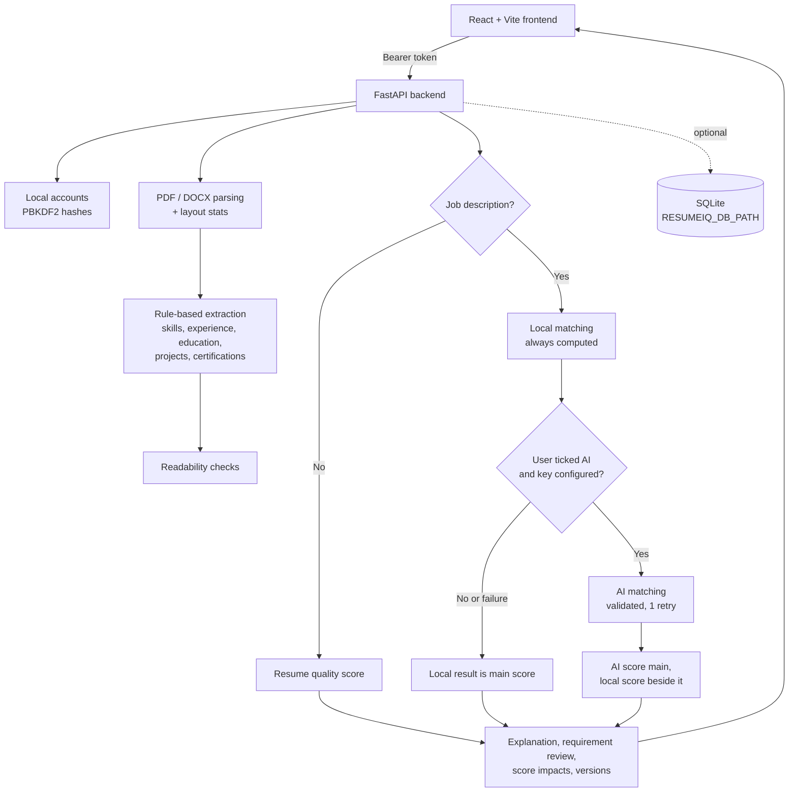

<div align="center">

# 📄 ResumeIQ
### Explainable Resume Evaluation, Evidence-Based Feedback

**Upload a resume. See exactly how it matches a job. Improve it honestly.**

A full-stack resume evaluation application built with **React + FastAPI**: requirement-by-requirement matching with quoted evidence, a transparent score breakdown, grounded improvement suggestions, and optional AI that never hides the local result.


**Requirement matching** · **Explainable scoring** · **Grounded AI rewrites** · **Readability checks** · **Privacy controls**

</div>

---

## ✨ Why ResumeIQ?

Most resume checkers hand back a single number. ResumeIQ shows its work: which job requirements the resume evidences, which it doesn't, the exact formula behind the score, and which honest changes would move it.

Everything runs on **local rules by default**. AI is opt-in per action. When it is used, its output is validated, labelled as inference where it can't be verified, and shown beside the local result rather than replacing it.

> Scores are indicative heuristics, not official ATS scores or hiring probabilities.

## 🚀 What it offers

| Feature | How it works |
|---|---|
| 🎯 **Requirement review** | Each job-description requirement is marked *Matched*, *Partial*, *Not evidenced* or *Can't assess*, with a reason, an evidence-or-inference label and a quote from the resume. Display-only: it never changes the score. |
| 📊 **Explainable scoring** | Shows the exact formula, component points and weights. Preferred-only skills count half, and a weak-fit cap stops a polished resume from rescuing the wrong role. |
| 📈 **What would change this score** | Re-runs the same scoring rules on hypothetical edits (for example, "Show your Kubernetes experience: +12 job fit"). Every suggestion is conditional on being true. |
| ✍️ **Improvement assistant** | Flags weak openings, passive voice, missing outcomes and long bullets. Optional AI rewrites are kept only if a grounding validator confirms they add no new numbers, tools, names or seniority. |
| 🔎 **Document readability** | Detects image-only pages, contact details hidden in DOCX headers, text boxes, tables, icon fonts and unreadable dates, each with a fix. These are described as possible risks, not ATS guarantees. |
| 🤖 **Reliable optional AI** | The AI score stays primary with the local score always beside it. AI-matched skills are labelled *found in resume* or *inferred*, malformed output is retried once, and any fallback shows a banner. |
| 🔁 **Resume versions** | Re-analyze a revised resume against the same job to compare scores, skills added or removed, and requirement status changes. |
| 👥 **Recruiter workspace** | Per-job workspaces, batch upload of up to 5 resumes, review statuses with an audit trail, and side-by-side comparison with no automatic ranking. |
| 🔐 **Privacy controls** | A Privacy & data page shows what is stored and what AI calls send. Data can be deleted in one click and expires automatically when inactive. |
| 🧪 **One-click demo** | "Try a fictional sample" loads a bundled resume and job description through the real pipeline. |

Also included: light and dark themes, keyboard-accessible tabs, a responsive layout, a TXT summary and a print/PDF report.

## 🖼️ Project showcase

Add screenshots of the running app to `docs/screenshots/` and update the table below. The bundled fictional sample is ideal for this because it contains no real personal data.

| Upload & sample | Requirement review | Score breakdown | Improvement assistant |
|---|---|---|---|
| _screenshot_ | _screenshot_ | _screenshot_ | _screenshot_ |

## 🏗️ How it works



Business logic lives in the backend. The frontend renders backend results without recomputing scores.

## 🧰 Tech stack

| Layer | Technology |
|---|---|
| Frontend | React 19, Vite 8, plain CSS with design tokens, Oxlint |
| Backend | Python, FastAPI, Uvicorn, pypdf, python-docx |
| Matching & scoring | Rule-based Python modules (default) |
| Optional AI | Any OpenAI-compatible provider via the OpenAI SDK (OpenRouter by default, or Google Gemini directly) |
| Authentication | Local accounts (salted PBKDF2) with bearer sessions |
| Storage | In memory by default; optional SQLite persistence |
| Delivery | Docker Compose (nginx + Uvicorn), GitHub Actions CI |
| Tests | Python `unittest`, Node `node:test` |

## 📁 Repository structure

```text
ResumeIQ/
├── backend/
│   ├── main.py              # API routes, retention, persistence wiring
│   ├── recruiter.py         # Recruiter workspaces router
│   ├── samples.py           # Bundled fictional demo resume and job description
│   ├── auth/                # Local accounts and sessions
│   ├── parser/              # PDF/DOCX/text parsing with layout stats
│   ├── extractor/           # Rule-based extraction and evidence quotes
│   ├── matcher/             # Job matching and requirement-line review
│   ├── evaluator/           # Scoring, explanation, impacts, checks, improvements, versions
│   ├── ai/                  # OpenRouter matching, grounded rewrites, privacy filtering
│   ├── utils/               # Limits, uploads, skills vocabulary, SQLite persistence
│   ├── tests/               # Synthetic unittest suites (no network, no real data)
│   └── Dockerfile
├── frontend/
│   ├── src/                 # App shell, results dashboard, recruiter workspace, styles
│   ├── tests/               # Component/state tests and a Playwright QA script
│   ├── Dockerfile
│   └── nginx.conf
├── docs/                    # Phase reports and verification notes
├── docker-compose.yml
├── .env.example
└── .github/workflows/ci.yml
```

## ⚡ Getting started

No API key is needed. AI features stay off until a key is configured and you opt in.

### Option A: Docker

```powershell
copy .env.example .env
docker compose up --build
```

Open **http://localhost:8080**. The API runs at http://localhost:8000, with a health check at `/api/health`. Compose turns on SQLite persistence in a named volume.

### Option B: Local development

Verified on Windows with Python **3.14.3**, Node **24.21.0** and npm **11.19.0**.

**Backend** (from the repository root):

```powershell
python -m venv backend/.venv
backend/.venv/Scripts/python.exe -m pip install -r backend/requirements.txt -c backend/constraints-baseline.txt
cd backend
.venv/Scripts/python.exe -m uvicorn main:app --reload --host 127.0.0.1 --port 8000
```

**Frontend** (second terminal):

```powershell
cd frontend
npm ci
npm run dev -- --host 127.0.0.1 --port 5173 --strictPort
```

Open **http://localhost:5173**, create a local account, then choose **Try a fictional sample** to see every feature. API docs are at http://localhost:8000/docs.

## ⚙️ Configuration

Every value is optional. See [`.env.example`](.env.example).

| Variable | Default / purpose |
|---|---|
| `AI_API_KEY` | Enables opt-in AI job matching and AI wording suggestions. Backend only; never put secrets in `VITE_*` values. (`OPENROUTER_API_KEY` is still accepted.) |
| `AI_BASE_URL` | Any OpenAI-compatible endpoint (https only); default `https://openrouter.ai/api/v1` |
| `AI_MODEL` | Model ID for that provider; default `openai/gpt-oss-20b:free` (`OPENROUTER_MODEL` is still accepted) |
| `ALLOWED_ORIGINS` | `http://localhost:5173`; comma-separated, exact scheme, host and port |
| `RESUMEIQ_DB_PATH` | Empty keeps working data in memory only. A file path persists it in SQLite. |
| `DATA_RETENTION_SECONDS` | `7200`; inactive users' working data is erased after this period |
| `SESSION_TTL_SECONDS` | `3600` |
| `VITE_API_BASE_URL` | Frontend build setting; `http://localhost:8000` |
| `MAX_RESUME_BYTES`, `MAX_JD_BYTES`, `MAX_TEXT_CHARS`, `MAX_PDF_PAGES`, … | Resource limits (see `backend/utils/limits.py`) |

The backend doesn't load `.env` by itself. Docker Compose passes it in; locally, use Uvicorn's `--env-file`.

### Using Google Gemini directly

Create a key in Google AI Studio, then set (PowerShell, before starting the backend):

```powershell
$env:AI_BASE_URL = "https://generativelanguage.googleapis.com/v1beta/openai/"
$env:AI_API_KEY = "your-gemini-key"
$env:AI_MODEL = "gemini-2.5-flash"
```

Check Google's documentation for current model IDs. With a Gemini key, opted-in AI requests go to Google; review Google's data-use terms (free-tier data may be used to improve their products) before using real resumes. If the provider rejects a request or returns unusable output, ResumeIQ falls back to local results and shows a banner.

## 🔒 Privacy and data handling

- **Files are never kept.** Uploads are parsed and discarded. Extracted fields, analyses, history, version snapshots (scores, skills and requirement statuses only) and workspaces are held in memory, or in SQLite when `RESUMEIQ_DB_PATH` is set.
- **Working data expires.** It is erased after `DATA_RETENTION_SECONDS` of inactivity, on request (`DELETE /api/me/data` or the Privacy page), and on restart when persistence is off.
- **Accounts are local.** They live in `backend/data/users.json` with salted PBKDF2 hashes. Writes are atomic, and a corrupt file stops startup rather than wiping accounts. Sessions are in memory, so a restart means signing in again.
- **AI is opt-in.**
  - Job matching sends skills, education, and employment titles, dates and descriptions (with best-effort contact redaction), plus the job description.
  - Wording suggestions send only flagged employment bullets with no names, organizations, contact details or sensitive attributes.
  - Projects, evidence quotations and files are never sent.
  - Redaction is best effort, not anonymization.
- **Not a hiring decision.** Scores are decision support only. Comparisons never rank candidates automatically.

## 🔌 API

| Method/path | Behavior |
|---|---|
| `POST /api/signup`, `/api/login`, `/api/logout` | Local accounts; bearer tokens |
| `POST /api/upload` | Multipart `file` (PDF/DOCX): extraction, categorization, readability checks |
| `POST /api/upload/sample` | Loads the bundled fictional resume and returns a sample job description |
| `POST /api/analyze` | `resume_id`, optional `job_description` text or `file`, optional `use_ai`. Returns the analysis, history, versions and a version comparison. |
| `POST /api/improvements` | `resume_id`, `analysis_id`, optional `use_ai` for grounded AI wording suggestions. Cached; never rescores. |
| `GET /api/history`, `GET /api/versions` | Recent evaluations; version snapshots and comparison |
| `GET /api/me/data`, `DELETE /api/me/data` | What is stored for the account; erase it |
| `GET /api/health` | Liveness and storage mode (no user data) |
| `/api/workspaces/...` | Recruiter workspaces, batch uploads, review statuses, comparison |

Stale `resume_id`, `analysis_id` or workspace versions return **409**.

## 🧪 Testing

```powershell
cd backend
.venv/Scripts/python.exe -m unittest discover -s tests
.venv/Scripts/python.exe -m pip check
```

```powershell
cd frontend
node --test tests/*.test.js
npm run lint
npm run build
```

**270 backend tests** and **47 frontend tests** pass, and lint, build and `pip check` are clean. Tests use synthetic data, mock every AI call and block network access. GitHub Actions runs both suites on pushes and pull requests. `frontend/tests/browser-qa.mjs` is a Playwright scenario script that needs Playwright installed separately.

## ⚠️ Known limitations

- Extraction is rule-based with a bounded skill vocabulary. Complex layouts, unusual headings and scanned PDFs (no OCR) can lose information.
- Requirement statuses based on related skills or similar wording are inferences. Certification validity and degree field or completion are not verified.
- The rewrite validator is deliberately strict and may reject useful AI output. It still allows plain verb changes, so every draft needs human review.
- Sessions live in process memory and the API runs a single worker. A restart signs users out; persisted working data remains when SQLite is enabled.
- The Docker images and CI workflow were written for this release but not yet built or run in the verification environment.
- Exports are reports, not rewritten resume files. Print-to-PDF uses the browser dialog.

## 🗺️ Future improvements

- OCR for scanned resumes, behind an explicit opt-in.
- Persistent sessions and a multi-worker deployment.
- A data-driven skill vocabulary for more industries.
- Configurable scoring presets for recruiter workspaces.
- Screenshots and a hosted demo.

## 💡 What I learned

ResumeIQ brings together **frontend design, API design, document parsing, explainable scoring, privacy engineering and responsible AI integration**. The central design goal is to give useful, honest feedback that shows its evidence, without letting an external AI service silently decide the result.

Historical phase reports live in [`docs/`](docs/).

---

<div align="center">

### Built with curiosity, code, and continuous learning ✨

**ResumeIQ: understand your resume, improve it honestly.**

</div>
