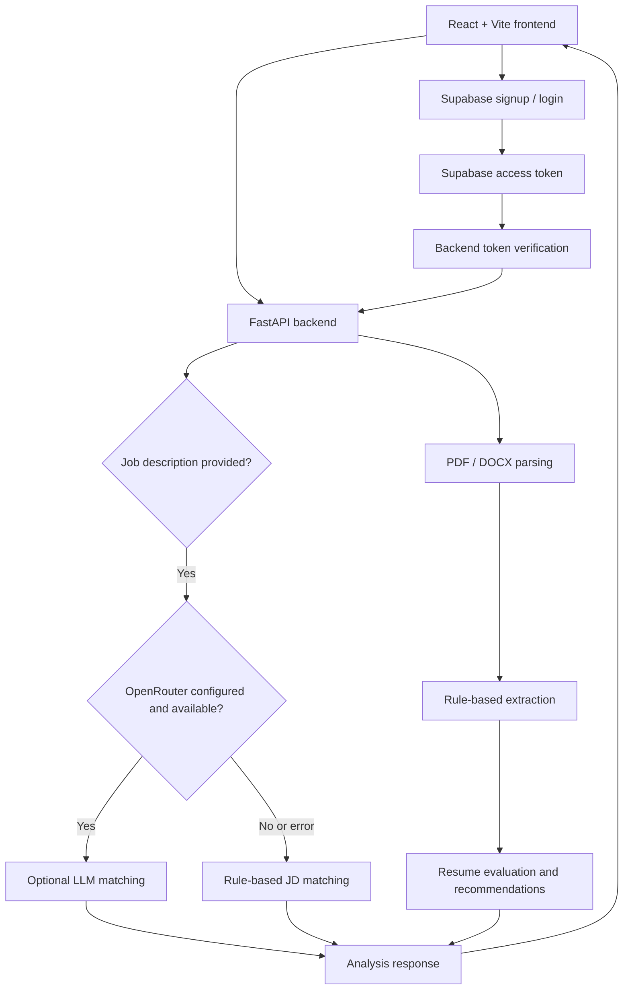
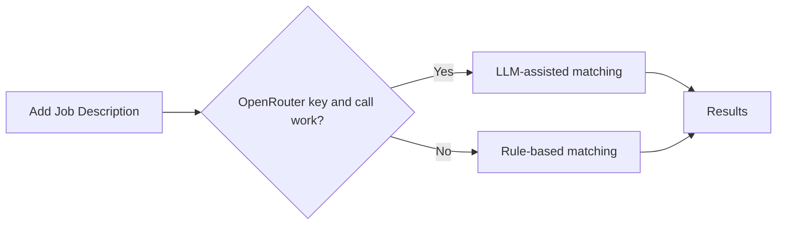

<div align="center">

# 📄 ResumeIQ
### Smarter Resume Evaluation, Clearer Career Insights

**Upload a resume. Understand its strengths. Compare it with a job description.**

A full-stack resume evaluation application built with **React + FastAPI**, combining structured resume analysis, practical recommendations, and optional AI-assisted job-description matching.


**Resume parsing** · **Rule-based evaluation** · **Job-description matching** · **Secure login** · **Optional AI insights**

</div>

---

## ✨ Why ResumeIQ?

A resume can contain great experience and still be difficult to evaluate against a specific role. **ResumeIQ** brings resume analysis and job-description comparison into one straightforward workflow, helping users understand their resume and identify potential improvements.

Rather than depending entirely on an external AI service, the application uses **rule-based processing by default**. AI-assisted job-description matching is optional, and the app falls back to rule-based matching if that service is unavailable.

## 🚀 What it offers

| Feature | How it works |
|---|---|
| 📤 **Resume upload** | Upload a resume using the React interface; backend parsing supports PDF and DOCX. |
| 🔎 **Information extraction** | Rule-based extraction processes resume information. |
| 📊 **Resume evaluation** | Evaluation modules calculate scores and recommendations. |
| 🎯 **Job-description matching** | Compare resume content against a job description. |
| 🤖 **Optional AI matching** | OpenRouter can enhance semantic job-description matching when configured. |
| 🛟 **Reliable fallback** | If the AI key is missing or the call fails, the application uses its rule-based matcher. |
| 🔐 **Authentication** | Supabase handles signup and login; FastAPI verifies Supabase-issued access tokens. |

> **Scope note:** Resume upload and extraction are rule-based. The optional LLM is used for the **Add Job Description** matching step, not for resume extraction. Resume and evaluation data are held **in memory** by the backend; there is no application database for that data.

## 🖼️ Project showcase

Add real screenshots of your running app to a `docs/screenshots/` directory and update the paths below.

| Resume upload | Evaluation results |
|---|---|
| Add a screenshot of the upload interface | Add a screenshot of the results interface |

**Suggested screenshots:** upload screen, evaluation overview, job-description matching, and login/signup. Avoid showing real resume personal data or API credentials.

## 🏗️ How it works



The frontend communicates with the backend over HTTP. Authentication is managed by Supabase; the backend **verifies tokens**, rather than storing or managing user passwords itself.

## 🧰 Tech stack

| Layer | Technology |
|---|---|
| Frontend | React, Vite, JavaScript |
| Backend | Python, FastAPI |
| Resume formats | PDF, DOCX |
| Extraction and default matching | Rule-based Python modules |
| Optional AI matching | OpenRouter API |
| Authentication | Supabase Auth |
| Data storage | Resume/evaluation data in backend memory (no app database) |

## 📁 Repository structure

```text
ResumeEvaluator/
├── backend/
│   ├── main.py              # FastAPI application
│   ├── parser/              # PDF/DOCX resume parsing
│   ├── extractor/           # Rule-based information extraction
│   ├── evaluator/           # Scoring and recommendations
│   ├── matcher/             # Rule-based job-description matching
│   ├── ai/                  # Optional OpenRouter matching
│   ├── auth/                # Supabase access-token verification
│   └── utils/               # Validators and constants
├── frontend/                # React + Vite application
├── assets/                  # Static assets
├── sample_resumes/          # Sample resume files
└── tests/                   # Test files
```

## ⚡ Getting started

### 1. Configure Supabase (required)

Supabase provides user **signup and login**. The FastAPI backend verifies the issued access token.

1. Create a project at [Supabase Dashboard](https://supabase.com/dashboard).
2. Open **Authentication → Providers** and enable **Email**.
3. For easier local testing only, you may disable **Confirm email**; use an appropriate verification policy for real deployments.
4. Under **Project Settings → API**, find the project URL and **anon public** key.

Create `frontend/.env`:

```dotenv
VITE_SUPABASE_URL=https://your-project.supabase.co
VITE_SUPABASE_ANON_KEY=your_supabase_anon_key
```

For the backend, set the corresponding values in PowerShell:

```powershell
$env:SUPABASE_URL = "https://your-project.supabase.co"
$env:SUPABASE_ANON_KEY = "your_supabase_anon_key"
```

> Never commit real environment files or private API credentials. The Supabase **anon** key is intended for client applications; do not replace it with a secret service-role key in the frontend.

### 2. Start the FastAPI backend

In **PowerShell**:

```powershell
cd backend
pip install -r requirements.txt
$env:SUPABASE_URL = "https://your-project.supabase.co"
$env:SUPABASE_ANON_KEY = "your_supabase_anon_key"
python -m uvicorn main:app --reload --port 8001
```

**Backend:** `http://localhost:8001`  
**FastAPI documentation (when enabled):** `http://localhost:8001/docs`

### 3. Start the React frontend

Open a **second terminal**:

```powershell
cd frontend
npm install
npm run dev
```

**Frontend:** `http://localhost:5173`  
The frontend talks to the backend at `http://localhost:8001`.

## 🤖 Optional: AI-powered job-description matching

By default, **job-description matching is rule-based**. To enable the optional OpenRouter path, configure an API key before starting the backend:

```powershell
$env:OPENROUTER_API_KEY = "your_openrouter_api_key"
python -m uvicorn main:app --reload --port 8001
```

Get a key at [OpenRouter](https://openrouter.ai/settings/keys).

The model is configured in `backend/ai/openrouter_client.py` and defaults to:

```text
openai/gpt-oss-20b:free
```

You can change it without editing the application code:

```powershell
$env:OPENROUTER_MODEL = "your_preferred_model_slug"
python -m uvicorn main:app --reload --port 8001
```

**How the fallback works:**



Check `job_fit_method` and, where present, `job_fit_model` in the `/api/analyze` response to see which matching path actually ran.

> OpenRouter model availability and pricing can change. A `:free` model slug identifies a free-tier route, but service limits and access conditions may apply. The app remains usable with rule-based matching if OpenRouter is unavailable.

## 🔒 Privacy and design notes

- **Supabase handles authentication**; your FastAPI backend verifies access tokens.
- **Resume extraction is rule-based**, regardless of whether optional AI matching is enabled.
- **No application database** stores resumes or evaluation results; those are kept in backend memory.
- **OpenRouter is optional**; using its matching feature sends relevant job-description/resume context to an external provider. Review data-handling considerations before using real sensitive documents.
- The application is **not a guarantee of hiring outcomes**; its scores and recommendations are decision-support feedback.

## 🧪 Testing and development

The repository includes a `tests/` directory. Follow the test setup and dependencies included in your project when running them; this README does not claim a specific passing test count.

For local development, keep the backend and frontend running in separate terminals. Use the browser developer tools and the FastAPI response (`job_fit_method`) to investigate whether the rule-based or optional AI route was used.

## 🗺️ Future improvements

Potential directions for future development:

- Better PDF/DOCX layout handling and extraction quality.
- More transparent breakdowns of evaluation scores and recommendations.
- Additional test coverage for authentication and complex resume formats.
- Privacy-conscious storage options for users who explicitly want saved history.
- Expanded job-description matching evaluation across different industries.
- Deployment documentation and monitoring for hosted environments.

## 💡 What I learned

Building ResumeIQ brings together **frontend development, backend APIs, authentication, document processing, and practical matching logic** in one full-stack workflow. The key design goal is to provide useful feedback **without making the whole application depend on an external AI API**.

---

<div align="center">

### Built with curiosity, code, and continuous learning ✨

**ResumeIQ — Understand your resume. Improve your next application.**

</div>
